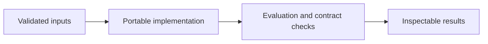

# Conversion Experiment Analysis

**Feras Elghandour** · Technical case study

Determine whether a treatment page has a higher conversion rate than the control and distinguish observed effect size from simulation uncertainty.

## Implementation

A count-based conversion analysis with a seeded binomial null simulation, finite-simulation correction, and a difference interval.



## Completed study

The saved analysis contains 69,889 observations. Control conversion is 10.5254% and treatment conversion is 15.5321%, a difference of 5.0067 percentage points. None of 500 null simulations is as extreme; the adjusted Monte Carlo estimate is 1/501, approximately 0.002.

These historical figures describe the completed study. This refactored standalone implementation has separate validation and has not been used to recertify the historical benchmark. The public release contains the portable core and focused tests.

## Run locally

Python 3.11 or later.

```sh
python -m venv .venv
source .venv/bin/activate
python -m pip install -r requirements.txt
python smoke_test.py
python experiment.py
```

Prepare your own inputs as described in [DATA.md](DATA.md). Tests use generated fixtures and do not need credentials or provider calls. [VALIDATION.md](VALIDATION.md) records their scope.

## Practical relevance and limitations

A simulation count of zero is not a true p-value of zero. Interpreting the difference causally requires valid random assignment, independent observations, and a trustworthy experiment design.

This edition makes the core behavior reusable and inspectable. Historical metrics and synthetic contract tests provide different kinds of evidence; neither establishes client deployment or commercial impact.
