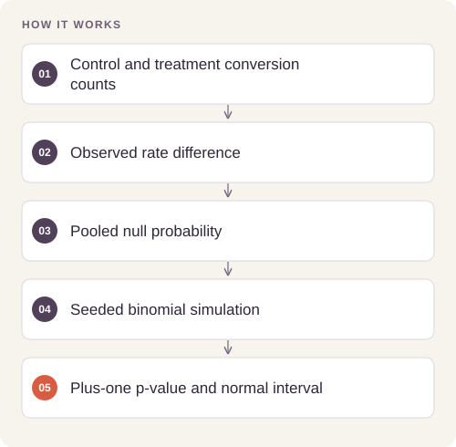

# Conversion Experiment Analysis

Determine whether a treatment page has a higher conversion rate than the control and distinguish observed effect size from simulation uncertainty.

## Implementation

A count-based conversion analysis with a seeded binomial null simulation, finite-simulation correction, and a difference interval.




## Reproduce and inspect

The executable reproduction profile now records exact commands, input/source hashes, dependency versions, logs and pass/fail status. Its scope distinguishes behavior checks from full-data benchmarks.

[Commands, artifacts and benchmark scope](BENCHMARKS.md) · [Versioned profiles](reproduction.json)


## Try a small example

Retained aggregate conversion counts exercise the seeded simulation. Statistical significance alone does not establish randomization quality or causal validity.

After the local setup below, run from the repository root:

```sh
python examples/quickstart.py
```

The [example source](examples/quickstart.py), [captured output](examples/expected-output.txt) and [execution record](examples/environment.json) keep this demonstration inspectable. Floating-point values may vary with library versions.

Observed output from this run:

```text
{
  "control_rate": 0.1052540515600669,
  "treatment_rate": 0.15532078043793132,
  "difference": 0.050066728877864425,
  "difference_normal_95_interval": [
    0.04509214289835049,
    0.05504131485737836
  ],
  "null_draws": 500,
  "right_tail_adjusted_p": 0.001996007984031936,
  "seed": 42
}
```

## Completed study

The saved analysis contains 69,889 observations. Control conversion is 10.5254% and treatment conversion is 15.5321%, a difference of 5.0067 percentage points. None of 500 null simulations is as extreme; the adjusted Monte Carlo estimate is 1/501, approximately 0.002.

These historical figures describe the completed study. This refactored standalone implementation has separate validation and has not been used to recertify the historical benchmark. The public release contains the portable core and focused tests.

## Run locally

Python 3.11 or later.

```sh
python -m venv .venv
source .venv/bin/activate
python -m pip install -r requirements.txt
python smoke_test.py
python experiment.py
```

Prepare your own inputs as described in [DATA.md](DATA.md). Tests use generated fixtures and do not need credentials or provider calls. [VALIDATION.md](VALIDATION.md) records their scope.

## Practical relevance and limitations

A simulation count of zero is not a true p-value of zero. Interpreting the difference causally requires valid random assignment, independent observations, and a trustworthy experiment design.
